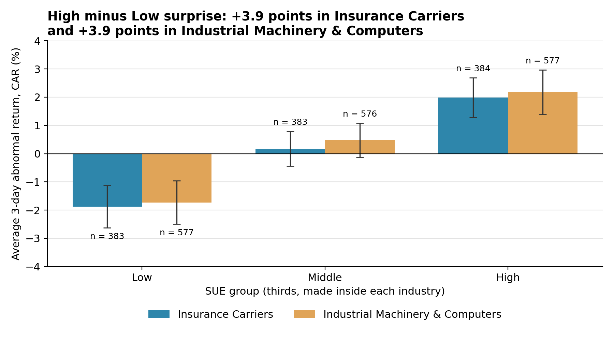
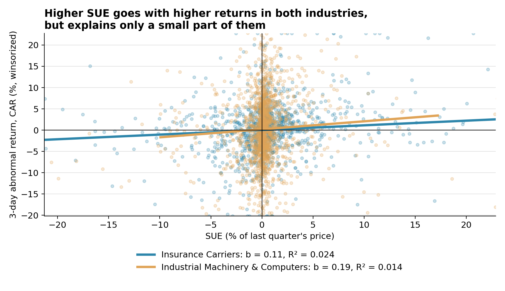
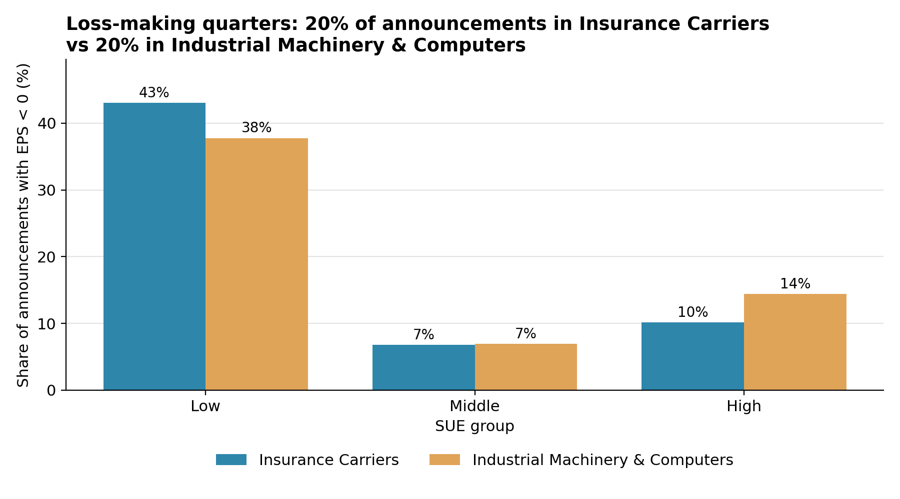
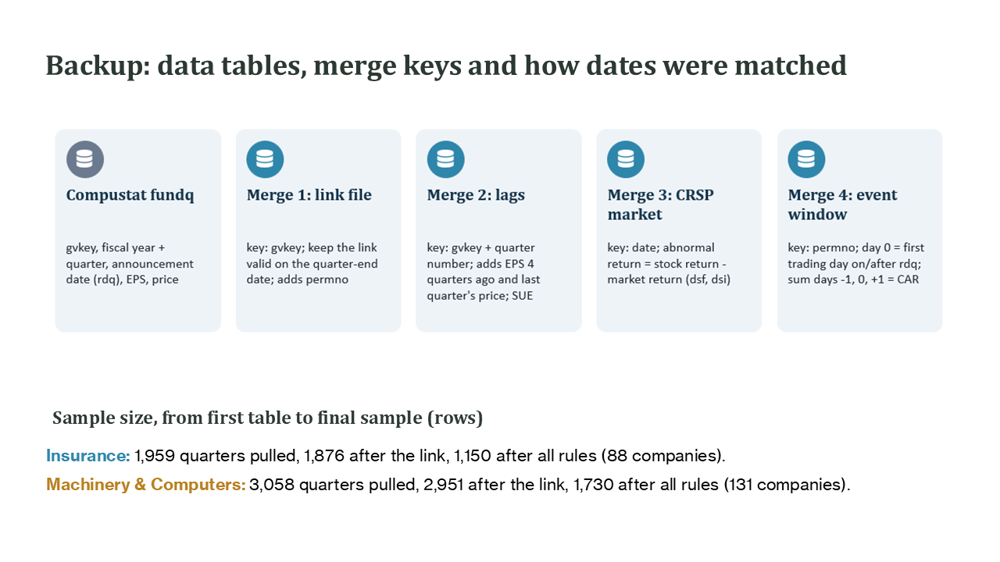

 How much does Progressive’s stock move when earnings beat or miss expectations?

**Author:** Matthew Culhane · BAN 4550, Fall 2026 · Industry: 63 Insurance Carriers · Comparison industry: 35 Industrial Machinery & Computer Equipment

## The question
Mr. Harry Potter wants to know whether or not better-than-expected earnings lead to a higher stock reaction, and whether insurance is different from the comparison industry.

## Main result
The main result confirmed that better-than-expected earnings lead to a higher stock reaction because people are happier with the increased returns. Our result also found that 
insurance did not differ from the comparison industry. Insurance: Low = −1.88%, Middle = +0.18%, High = +1.98% over 3 days, a gap of 3.86 percentage points.
Machinery: Low = −1.73%, High = +2.18%, a gap of 3.90% points.

## Is the difference real?
The t-test shows a 3.86 percentage-point difference in Insurance and a 3.90 percentage-point difference in Industrial machinery. The P-values for both industries are <0.001, indicating a statistically significant difference from zero. In plain words, yes, firms with better earnings surprises had higher stock reactions over the 3 days around the announcement.

## Why the industries differ

The reason we tested was to see how the industries differ when it comes to loss-making quarters. The reason that they may differ is that when a natural disaster occurs, insurance companies have to pay out, making their profits less than usual, therefore affecting stock reaction.

## Advice for the client
- **Business implication:** Insurers in the top third of surprises gained about 2% (vs the market) over 3 days; the bottom third lost about 2%. Plan investor messaging around announcement days, especially when profit falls versus last year. The same pattern shows up in Machinery & Computers, so it is not special to insurance.
- **Limitation:** Our surprise compares with last year's profit, not with analysts' forecasts.
Surprise explains only a small share of the reaction (R-squared 0.014 in Machinery,  0.024 in Insurance).
We only have data from 2019 to 2024. There is more historical data that we do not have
- **Next questions:** 
Predictive: Can we predict Progressive's next earnings reaction from the surprise plus its own business signals?
Prescriptive: Should Progressive give earnings guidance or pre-announce bad news to soften the reaction?
## Data
- Sources: Compustat (`comp.fundq`), CRSP (`crsp.dsf`, `crsp.dsi`), accessed through WRDS.
- The data are not included in this repository because of the WRDS license. Someone with WRDS access can rebuild the results by running the notebook with the link file in the same folder.
- Sample period and rules:
  Insurance: 1,959 quarters pulled, 1,876 after the link, 1,150 after all rules (88 companies).
  Industrial Machinery & Computers: 3,058 quarters pulled, 2,951 after the link, 1,730 after all rules (131 companies).
## How the tables fit together
We needed to merge the data to get the data on the same page in order to run the regressions. We got the data from the shared link, and then merged the variables in four separate merges to get cleaned data that can be used. The date rule is that day 0 is the first trading day on or after the announcement date. This allows us to move day 0 to a trading day if the market is closed, and therefore the reaction shows up on the next trading day.

## How I checked the results
One real check is by looking at the average of the CAR when removing the top 5 greatest CARs, as they may be outliers that skew the data. There is a chance that the biggest outliers carry the data in a direction that looks better on average than it really is. A check would be to remove the top 5 greatest CARs and then see the average. Before the removal, the High group CAR was 1.984%. After removal, the high group CAR was 1.8884%.
## Changes since Project 2
| What was wrong | How I fixed it | How the results changed |
What was wrong: Small thing: you have a few leftover cells that guard against re-running (for example if "td" in stock.columns: ...). They are harmless, but remove them once your notebook runs cleanly from top to bottom, so the code is easier to read. ANN_START / ANN_END defined twice (second time as Timestamps). 
Fixed with: 
import warnings
warnings.filterwarnings("ignore", category=FutureWarning)   # hide a harmless pandas warning
import pandas as pd
import wrds
conn = wrds.Connection()    # log in to WRDS (type your username and password if asked)
# Settings. If you want to change something, change it here only.
SIC        = "63"            # Insurance Carriers; Progressive is SIC 6331
FY_START   = "2021-01-01"     # we study fiscal years that END between FY_START and FY_END
FY_END     = "2024-12-31"
PULL_START = "2019-06-01"     # we pull earlier years too, because the EPS change needs last year's EPS and price
RET_START  = "2020-12-01"     # include the trading day before the first possible announcement
RET_END    = "2025-01-31"     # include the trading day after the last possible announcement
ANN_START  = pd.Timestamp("2021-01-01")
ANN_END    = pd.Timestamp("2024-12-31")
MIN_PRC    = 5                # rule: drop a company-quarter if last quarter's price is below this
MAX_CHG    = 1                # rule: drop a company-quarter if absolute SUE is above this

# 8-0. Remove the columns this cell creates, in case the cell was run before.
if "td" in stock.columns:
    stock = stock.drop(columns=["td"])

for c in ["td0", "day0", "car", "days_found"]:
    if c in events.columns:
        events = events.drop(columns=[c])
|How the results changed|: 
Results changed because it removed unguarded cells, making the data more precise, and removing the annual start and annual end removed the duplicated timestamp.
## Where the code came from
| AI tool | Link (or PDF in docs/) | What I used it for |
| --- | --- | --- |
| Claude | Share Link | [https://claude.ai/share/c234a676-8a40-421d-adf5-670f1703ae98] | Used for coding and explanation, and powerpoint/slideshow construction

## Files
notebooks/   [Notebook](<CulhaneWilliams_Matthew_Project3(2).ipynb>) (runs top to bottom on WRDS JupyterHub)
figures/     figure1_car_by_group.png, figure2_scatter.png, figure3_loss_share.png, merge_map.png
docs/        [Slides (PDF)](CulhaneWilliams_Matthew_Project3.pdf)
README.md
